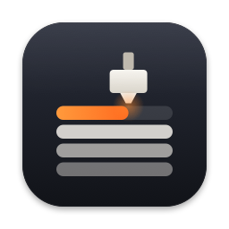
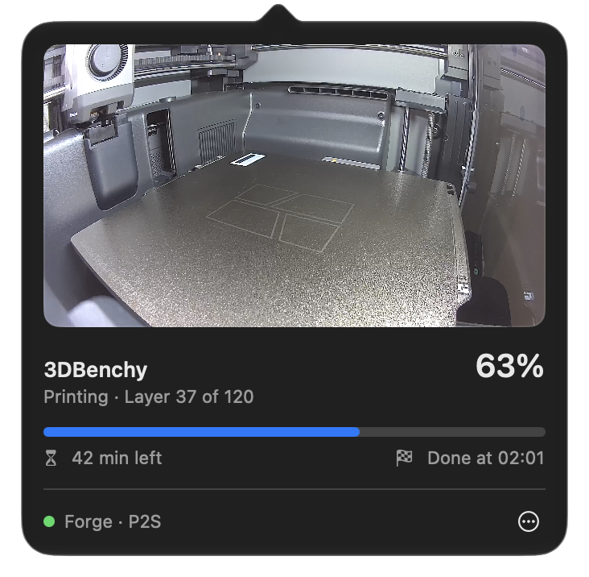

<div align="center">



# baski

Bambu Lab print progress and camera in your Mac menu bar.


</div>

<br>

My printer isn't next to my desk. When I wanted to see how a print was going, I had to open Bambu Studio, which is a lot of app just to look at a camera. So I made this for myself: the time left sits in the menu bar, and one click shows the camera.

*baskı* means "print" in Turkish.

<p align="center">
  
</p>

## Install

1. Download the latest `baski-x.y.z.dmg` from [Releases](../../releases) and drag **baski** to Applications.
2. Open it once. macOS blocks it because it isn't notarized. Go to **System Settings → Privacy & Security** and click **Open Anyway**.
3. Allow **Local Network** access when asked.
4. On the printer, turn on **LAN Only Liveview** (Settings → Network). This is not *LAN Only Mode*, so the cloud and Bambu Handy keep working.

baski uses two things from **Bambu Studio**: the printer's access code and its camera helper. If the camera says the tools are missing, open the printer's live view in Studio and turn on the **virtual camera** once. If the printer isn't found, use **⋯ → Add Printer**.

## How it works

The printer announces itself on the local network, and baski reads its status from the printer's own MQTT server. The camera stream comes through Studio's `bambu_source` helper and is decoded in hardware. That comes to about 4% CPU while the camera is open, and close to nothing otherwise. It's one Swift file with no dependencies, and nothing leaves your network.

Tested on a P2S. Other models should show status the same way; their camera paths are untested.

## Build

```sh
./build.sh install    # build and copy to ~/Applications
./build.sh dmg        # release image
tests/run.sh          # parser tests
```

You only need the Xcode Command Line Tools.

## Issues

Something not working, or tried it on another model? [Open an issue](../../issues/new). It helps to include your printer model and firmware, your macOS version, and the log from this command:

```sh
BASKI_DEBUG=1 /Applications/baski.app/Contents/MacOS/baski
```

<sub>MIT · Not affiliated with Bambu Lab.</sub>
